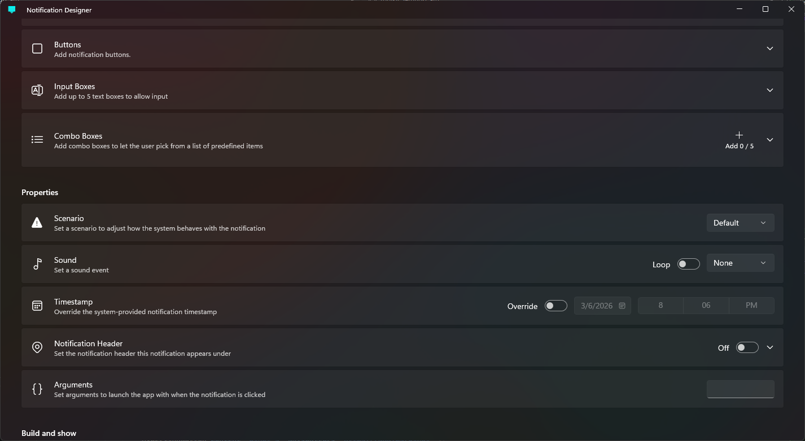

<p align="center">
  
</p>

<h1 align="center">Notification Designer</h1>

> [!WARNING]
> **Notification Designer** has been superseded by [Notification Editor](FireBlade211/Notification-Editor). You can still use **Notification Designer**, but consider checking out [Notification Editor](FireBlade211/Notification-Editor).

An app that allows you to generate Windows toast notifications through UI without manual XML editing.

## Screenshot


## Build the app
1. Clone the repository.
```pwsh
git clone https://github.com/FireBlade211/Notification-Designer.git
```
> [!TIP]
> The same command can be copied from the **About** section in the application settings.

2. Open `Notification Designer.slnx` (inside the `src` directory) in **Visual Studio 2026**.
3. On the **Build** menu, click **Build Solution**.
4. You can now access the app in the **Start** menu.

## To change settings
Click the **Menu** button in the top-left corner of the window (the app icon) and click **Settings**. Alternatively, you can press `Ctrl + ,`.

## Export the notification to code
**Notification Designer** does not currently support built-in exporting to code, but you can use Microsoft's [Notifications Visualizer](https://learn.microsoft.com/windows/apps/develop/notifications/notifications-visualizer) app and paste the XML data given by **Notification Designer**. Remove the **useButtonStyle** attribute because `Microsoft.Toolkit.Uwp.Notifications` does not support button colors as it was made before **Windows 11**. You can use button colors if you use the newer `AppNotification` APIs, though.
